<!--
 SHREYASH DANGE / Yashuuuu02
 Art-directed GitHub profile with locally hosted vector artwork.
 Project illustrations are conceptual; not product screenshots.
 Team projects are not presented as individual/solo achievements.
 No personal email, client secrets, private repo links, or private ownership information.
-->

  

  <a href="#selected-work">Selected Work</a>&nbsp;&nbsp;•&nbsp;&nbsp;
  <a href="#tech-stack">Tech Stack</a>&nbsp;&nbsp;•&nbsp;&nbsp;
  <a href="#github-activity">GitHub Activity</a>&nbsp;&nbsp;•&nbsp;&nbsp;
  <a href="#current-signal">Current Focus</a>&nbsp;&nbsp;•&nbsp;&nbsp;
  <a href="#beyond-the-editor">Beyond Code</a>&nbsp;&nbsp;•&nbsp;&nbsp;
  <a href="https://www.linkedin.com/in/shreyash-dange02/">LinkedIn ↗</a>

  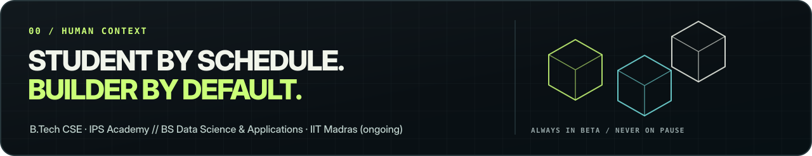

### `> whoami`

I'm **Shreyash Dange**, a developer based in Indore, India, working at the intersection of **applied AI, developer tools, and full-stack systems**. I'm interested in the engineering problems hiding behind a clean interface — data that needs grounding, unreliable connectivity, observability, maintainability, and making the product work outside a demo.

My work moves between **RAG and AI agents**, **backend architecture**, **developer-facing tools**, and **product engineering**. I care about how things *feel* to use just as much as how they *behave* under the hood.

> **Design it thoughtfully. Build it deliberately. Ship it reliably.**

## 01 — Selected work

Open-source work, research prototypes, and team-built products. The visuals are custom conceptual illustrations, not application screenshots.

<table>
  <tr>
    <td width="50%" valign="top" align="center">
      <a href="https://oriondev.in/">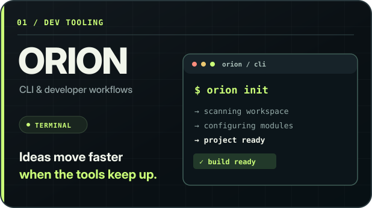</a>
       <b>Orion CLI</b> AI coding assistant &amp; automation • Go / Rust • In development
    </td>
    <td width="50%" valign="top" align="center">
      <a href="https://github.com/xvertere-org/Solarch">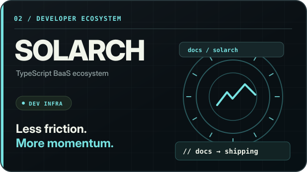</a>
       <b>Solarch</b> Open-source BaaS: auth, SQLite, storage &amp; real-time features • 5,000+ npm downloads
    </td>
  </tr>
  <tr>
    <td width="50%" valign="top" align="center">
      <a href="https://github.com/Yashuuuu02/neo">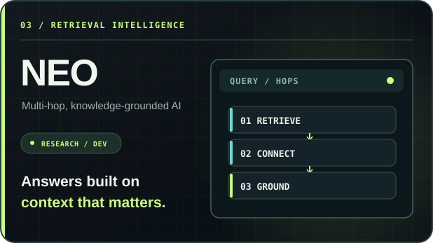</a>
       <b>Neo — AI Agent</b> Multi-hop RAG • Domain-specific knowledge grounding
    </td>
    <td width="50%" valign="top" align="center">
      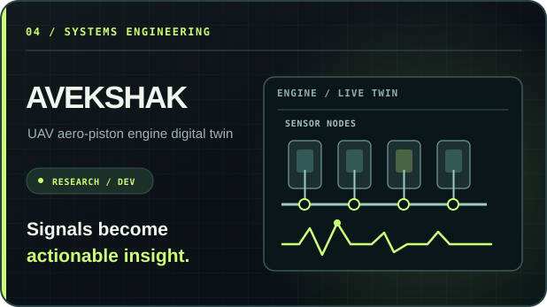
       <b>Avekshak — SIH</b> Digital twin • Engine health monitoring • Fault prediction
    </td>
  </tr>
  <tr>
    <td width="50%" valign="top" align="center">
      <a href="https://github.com/xvertere-org/Aadhaar-Netra">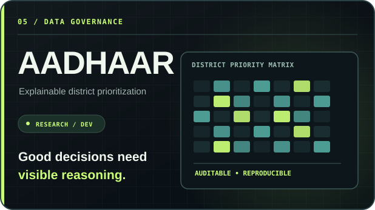</a>
       <b>Aadhaar Netra</b> Deterministic district prioritization • Explainable &amp; auditable metrics
    </td>
    <td width="50%" valign="top" align="center">
      <a href="https://fresher-os.pages.dev/">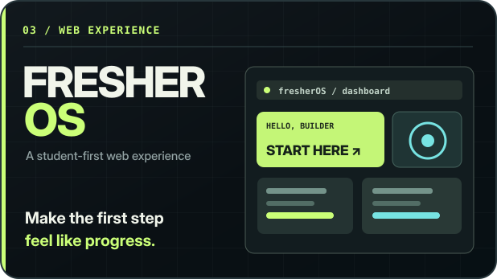</a>
       <b>Fresher OS</b> Interactive campus-tribe experience • Student-first web product
    </td>
  </tr>
</table>

Also explored: [Real Estate Demo](https://realestatedemo-project.vercel.app/) (website prototype) · [koolur](https://github.com/Jay-Suryawansh7/koolur) (colour utilities) · [lockguard](https://github.com/Jay-Suryawansh7/lockguard) (developer tooling). Some showcased work is collaborative; these links are not claims of solo authorship. Avekshak is unlinked because its repository URL in my résumé was not publicly accessible when checked.

## 02 — The technology stack

The languages, frameworks, AI systems, and infrastructure I actually work with. These are tools, not skill-level claims.

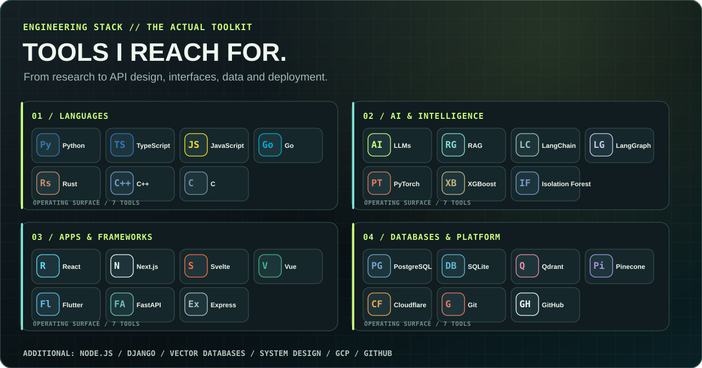

<!-- Real developer-tool icon artwork, distinct from the original graphic, powered by Skill Icons. -->

  

  
<b>Explore the complete toolkit ↗</b>

  | Discipline | Tools and techniques |
  | :-- | :-- |
  | **Languages** | Python, TypeScript, JavaScript, Go, Rust, C++, C |
  | **AI & ML** | LLMs, RAG, LangChain, LangGraph, DeepAgents, PyTorch, XGBoost, Isolation Forest, reinforcement learning, contextual bandits |
  | **Frontend** | React, Next.js, Svelte, Vue, HTML, CSS, Flutter |
  | **Backend** | FastAPI, Express, Django, Node.js, API design |
  | **Data** | PostgreSQL, SQLite, Chroma, Pinecone, Qdrant, vector search |
  | **Platform** | Cloudflare, Google Cloud, Git, GitHub, RunPod |
  | **Engineering** | System design, evals, data governance, explainable AI, offline-first systems |

## 03 — Live GitHub telemetry

Live GitHub account data for <a href="https://github.com/Yashuuuu02">@Yashuuuu02</a>. The cards request fresh data from GitHub through their respective services, subject to caching and rate limits — no manually entered commit totals.

  
  

  

  

  
<b>Locally hosted backup cards — refreshed automatically by GitHub Actions ↗</b>

   

  
  

  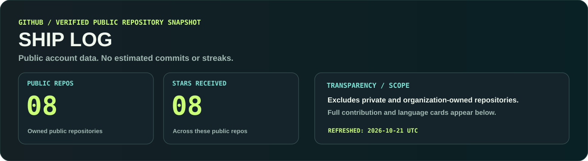

  The included workflow fetches the account's public stats when the profile is first published and twice a day afterward, then commits refreshed SVG cards to this repository. The backup graphics do not depend on public image-generation services when someone opens the profile.

**How counting works:** commit totals use GitHub's public author-commit data (with all-time counting enabled) and may differ from GitHub's contribution total, which includes qualifying commits, issues, PRs and other activity. Top languages measure code in detectable public owned repositories, not proficiency. Private contributions need separate authorized API access. Displayed values may lag due to API caching or workflow delays.

## 04 — Current signal

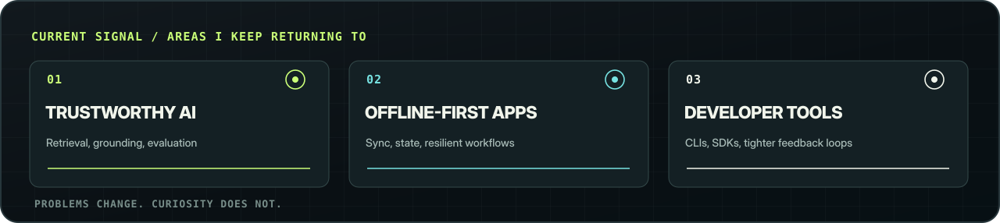

Currently exploring what makes **AI systems trustworthy enough to evaluate**, **software resilient to real-world failure modes**, and **developer tooling genuinely useful**. My favorite problems connect research ideas with production constraints.

## 05 — Beyond the editor

I also enjoy the part of building that doesn't fit into a commit: **collaboration, communicating ideas, technical leadership, and turning projects into things people actually use**.

- **Education:** B.Tech in Computer Science & Engineering — IPS Academy, Indore; BS in Data Science & Applications — IIT Madras *(both ongoing)*.
- **Hackathons:** **2nd place** — AI Manthan 2025; **3rd place** — VyapaarX 3.0.
- **Technical leadership:** Lead developer on Orion CLI; technical lead for an SIH 2026 project team.
- **Community:** Entrepreneurship Cell, IPS Academy — marketing, student outreach, and event execution.

  
<b>06 — Behind the build process</b>

   

  - **Start with constraints.** The real problem is usually more interesting than the pitch.
  - **Prototype, test, iterate.** Momentum matters, but so do edge cases.
  - **Respect the unglamorous work.** Auth, migrations, sync, and failure paths *are* product features.
  - **Care about design.** Good software needs to be both useful and intuitive.

---

  <a href="https://github.com/Yashuuuu02?tab=repositories">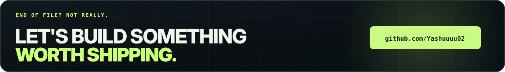</a>

  <a href="https://github.com/Yashuuuu02?tab=repositories">Explore repositories</a>
  &nbsp;·&nbsp;
  <a href="https://www.linkedin.com/in/shreyash-dange02/">Connect on LinkedIn</a>

<!-- GitHub renders this Markdown and external SVG URLs; no client-side JS. Live cards use GitHub data via external providers; GitHub Actions refreshes fallback SVG assets twice daily. -->
